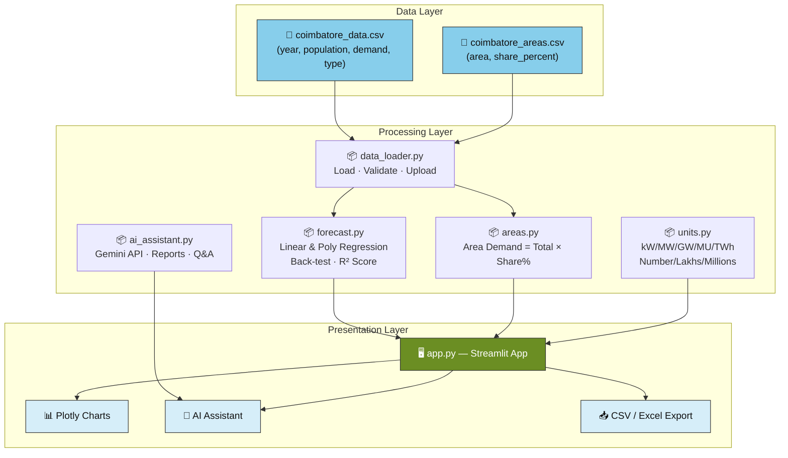
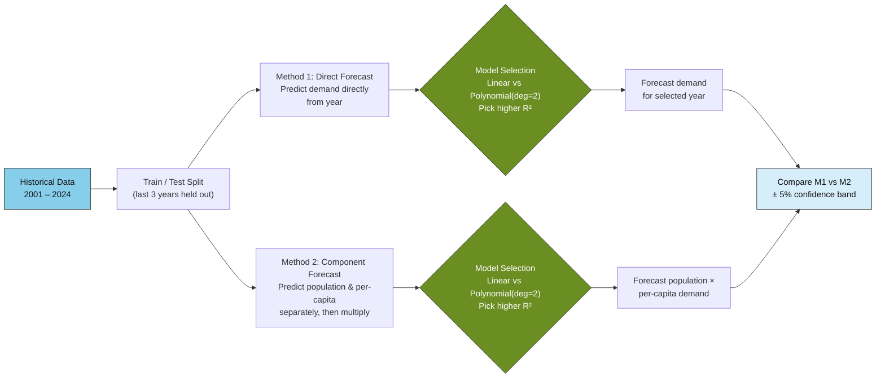
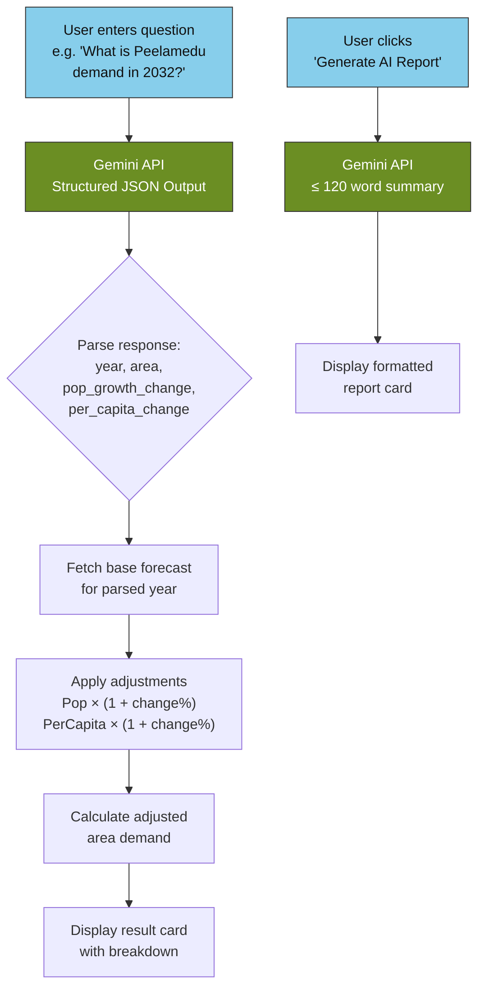

# ⚡ Coimbatore Demand Forecast

> **AI-Powered Electricity Demand Forecasting for Coimbatore**
>
> A Streamlit web application that visualises historical electricity demand
> and forecasts future demand for Coimbatore and its 10 key areas using
> machine-learning regression models and Google Gemini AI.

---

## 🏗️ Architecture Overview



---

## 🔮 Forecast Pipeline

The app uses **two independent forecasting methods** and compares them:



**Back-testing:** Models are trained on all data except the last 3 years,
then tested on those years. The model (Linear or Polynomial degree 2) with
the higher R² score is automatically selected.

---

## 🤖 AI Assistant Flow



---

## ✨ Features

### 📊 Six Interactive Tabs

| Tab | Description |
|-----|-------------|
| **Overview** | Result card showing demand for the selected year/area, cloud calculation card with step-by-step breakdown, and year-over-year KPI comparisons |
| **Charts** | Dual-axis line chart (population + demand), area bar chart, scatter plot (pop vs demand), pie charts (area shares & growth split), network diagrams (cause-effect & area connections), per-capita trend line |
| **Old Data** | Full historical data table with year-over-year growth percentages |
| **Forecast** | Model comparison table (Linear vs Polynomial with R² scores), Method 1 vs Method 2 forecast comparison, confidence band visualization |
| **AI Assistant** | Gemini-powered summary reports (≤120 words) and structured what-if Q&A with parameter adjustments |
| **Data** | View/upload CSV data, download results as CSV or Excel, download blank templates |

### 🔧 Key Capabilities

- **Smart Unit Selector** — Switch between kW / MW / GW / MU / TWh for demand and Number / Lakhs / Millions for population. All backend calculations stay in base units (MW, raw count).
- **10 Coimbatore Areas** — Gandhipuram, RS Puram, Peelamedu, Saibaba Colony, Singanallur, Ukkadam, Saravanampatty, Ganapathy, Vadavalli, Sulur — each with configurable demand share percentages summing to 100%.
- **Dummy Data Banner** — Automatically displays a warning banner when viewing data marked as `dummy` in the CSV.
- **CSV Upload** — Upload your own data/areas CSVs (validated on upload).
- **Export** — Download results and full forecasts as CSV or Excel.
- **20 Automated Tests** — pytest suite covering area shares, demand sums, R² sanity, unit round-trips, CSV validation, and more.

---

## 🗂️ Project Structure

```
coimbatore-demand-forecast/
├── app.py                  # Main Streamlit app (6 tabs, sidebar, charts)
├── config.py               # Colour palette, Gemini model, Plotly template
├── data_loader.py          # CSV loading, validation, templates, uploads
├── forecast.py             # sklearn Linear & Poly regression, back-testing
├── areas.py                # Area demand = total × share%
├── units.py                # Demand & population unit converters
├── ai_assistant.py         # Gemini API integration (reports & Q&A)
├── tests.py                # 20 pytest test cases
├── requirements.txt        # Python dependencies
├── .gitignore
├── .streamlit/
│   └── secrets.toml        # Gemini API key (git-ignored)
└── data/
    ├── coimbatore_data.csv  # Historical population & demand data
    └── coimbatore_areas.csv # 10 areas with share percentages
```

---

## 🚀 Quick Start

### 1. Clone the repository

```bash
git clone https://github.com/Srijith004/coimbatore-demand-forecast.git
cd coimbatore-demand-forecast
```

### 2. Install dependencies

```bash
pip install -r requirements.txt
```

### 3. Set your Gemini API key

Create `.streamlit/secrets.toml`:

```toml
GEMINI_API_KEY = "your-gemini-api-key-here"
```

Or use an environment variable:

```bash
# Windows
set GEMINI_API_KEY=your-key

# Linux / macOS
export GEMINI_API_KEY=your-key
```

### 4. Run the app

```bash
streamlit run app.py
```

The app opens at **http://localhost:8501**.

---

## 🧪 Running Tests

```bash
pytest tests.py -v
```

**20 tests** covering:

| Category | Tests |
|----------|-------|
| Area shares | Sum to 100%, individual share validation |
| Demand calculation | Area demand sums match total demand |
| Forecasting | R² score sanity checks, model selection logic |
| Unit conversion | Round-trip accuracy for all demand/population units |
| CSV validation | Schema validation, required columns, data types |
| Data integrity | Year range checks, population/demand positivity |

---

## 🛠️ Tech Stack

| Technology | Purpose |
|-----------|---------|
| **Python 3.10+** | Core language |
| **Streamlit** | Web application framework |
| **Plotly** | Interactive charts and visualisations |
| **pandas** | Data manipulation and analysis |
| **scikit-learn** | Linear & Polynomial regression models |
| **NetworkX** | Network/graph diagrams (cause-effect, area connections) |
| **Google Gemini API** | AI-powered reports and structured Q&A |
| **openpyxl** | Excel export support |
| **pytest** | Automated testing |

---

## 📈 Data Format

### `data/coimbatore_data.csv`

| Column | Type | Description |
|--------|------|-------------|
| `year` | int | Year (e.g. 2001, 2024) |
| `population` | float | Population count |
| `demand_mw` | float | Electricity demand in MW |
| `data_type` | string | `"dummy"` or `"official"` |

### `data/coimbatore_areas.csv`

| Column | Type | Description |
|--------|------|-------------|
| `area` | string | Area name (e.g. Gandhipuram) |
| `area_type` | string | Area classification (e.g. commercial, residential) |
| `share_percent` | float | Percentage share of total demand |
| `data_type` | string | `"dummy"` or `"official"` |

> **Note:** `share_percent` values across all areas must sum to **100.0**.

---

## ⚠️ Disclaimer

This application uses **simple regression models** trained on limited yearly
data. The forecasts are **indicative only** and should not be used for
official planning or policy decisions without validation against
authoritative sources.

---

## 📝 License

This project is developed as an academic assignment. Feel free to use and
modify for educational purposes.

---

<p align="center">
  Built with ❤️ using Streamlit & Gemini AI
</p>
